# Caderno da Vovó — Plano Mestre v4.0: Super Portal de Receitas, Lar, Saúde, Economia Doméstica & Memórias de Família

> [!IMPORTANT]
> **Repositório Oficial no GitHub:** [`https://github.com/Godopoa/caderno-da-vovo`](https://github.com/Godopoa/caderno-da-vovo)
> **Pasta Local do Projeto:** `C:\Users\dfuto\OneDrive\Documentos\CadernoDaVovo`
> **Stack Multiplataforma:** Node.js + Express + Prisma (SQLite) + React 18 + Vite + Tailwind CSS + FontAwesome 6 + Capacitor Android

---

## 1. Visão Geral da Expansão v4.0 (Além de Receitas: O Portal Diário da Dona de Casa e da Idosa)

Na versão **v4.0**, o **Caderno da Vovó** evolui de um portal de receitas para uma **Plataforma Completa de Vida Doméstica, Economia do Lar, Bem-Estar Sênior e Memórias de Família**. Todos os recursos foram desenhados com **zero emojis duplicados** (usando exclusivamente ícones vetoriais FontAwesome 6), **leitura em voz alta (Text-to-Speech)** e paleta editorial acolhedora (`#C83E5B` Framboesa, `#1E7E5A` Verde Sálvia, `#D97706` Dourado VIP e `#F8F6F2` Porcelana Quente).

```mermaid
flowchart TD
    subgraph Portal["Caderno da Vovó v4.0 — Ecossistema Completo"]
        R["Receitas & Modo Cozinha Estúdio"]
        E["Economia & Cozinha Inteligente"]
        S["Saúde, Chás & Bem-Estar"]
        C["Casa, Horta & Artesanato"]
        L["Livro de Receitas da Família (PDF)"]
        N["Jornalzinho & Comunidade"]
        A["Painel Admin + Robô Auto-Importer"]
    end

    E --> E1["Cardápio Semanal + Lista de Feira por Setor"]
    E --> E2["O Que Tem na Geladeira? (Zero Desperdício)"]
    E --> E3["Conversor de Medidas & Substituições"]
    E --> E4["Calculadora Faça e Venda (Renda Extra)"]

    S --> S1["Farmacinha Natural & Guia de Chás da Vovó"]
    S --> S2["Despertador de Remédios & Contador de Água"]

    C --> C1["SOS Tira-Manchas & Limpeza Caseira Segura"]
    C --> C2["Calendário da Safra do Mês & Horta em Vasos"]
    C --> C3["Cantinho do Crochê, Tricô & Artesanato"]

    L --> L1["Dedicatória + Capa Clássica + Exportação PDF"]
```



---

## 2. Os 10 Novos Módulos para Donas de Casa & Idosas (v4.0)

### Pilar 1: Economia do Lar & Cozinha Inteligente ([`KitchenEconomyHubPage.tsx`](file:///C:/Users/dfuto/OneDrive/Documentos/CadernoDaVovo/frontend/src/pages/KitchenEconomyHubPage.tsx))
1. **Cardápio Semanal Automático + Lista de Feira Inteligente**:
   - Permite planejar o almoço e o café/jantar de **Segunda a Domingo** ou clicar em **"Gerar Cardápio Econômico da Semana Automaticamente"**.
   - Soma e organiza os ingredientes necessários e permite enviar a **Lista de Compras da Semana no WhatsApp** ou imprimir.
2. **"O Que Tem na Geladeira?" (Combate ao Desperdício)**:
   - Seleção rápida de ingredientes que sobraram em casa (*arroz cozido, pão amanhecido, banana madura, frango desfiado, batata, ovos, leite, tomate*) + busca inteligente no catálogo de receitas e sugestões de reaproveitamento criativo da Vovó.
3. **Conversor de Medidas da Vovó & Guia de Substituições**:
   - Calculadora instantânea que converte **Xícaras, Colheres de Sopa, Gramas e Mililitros** levando em conta a densidade real de cada ingrediente (*farinha de trigo, açúcar, manteiga, óleo, leite, cacau, mel*).
   - Tabela de emergência **"Acabou um Ingrediente? Veja como Substituir"** (*ovo na massa, fermento químico, creme de leite, leite condensado, manteiga, buttermilk*).
4. **Calculadora "Faça e Venda" (Lucro & Renda Extra em Casa)**:
   - Ferramenta financeira simplificada para donas de casa e avós que vendem bolos caseiros, doces, pães ou salgados: calcula custo total de insumos, acréscimo de gás/luz/embalagem, margem de lucro desejada, **preço sugerido por unidade** e **estimativa de lucro mensal**.

---

### Pilar 2: Saúde, Chás & Rotina de Cuidado Sênior ([`HealthWellnessHubPage.tsx`](file:///C:/Users/dfuto/OneDrive/Documentos/CadernoDaVovo/frontend/src/pages/HealthWellnessHubPage.tsx))
5. **Farmacinha Natural & Guia de Chás da Vovó**:
   - Catálogo pesquisável por necessidade (*Dormir Melhor, Digestão e Azia, Gripe e Garganta, Calma e Ansiedade, Inchaço e Retenção, Imunidade*), com proporção exata da erva, tempo de infusão, leitura em voz alta (TTS) e avisos importantes de contraindicação (ex.: pressão alta, gestantes).
6. **Despertador de Remédios & Hidratação Diária (8 Copos d'Água)**:
   - Painel salvo no dispositivo (`localStorage`) onde a idosa cadastra seus medicamentos (nome, horário, dose, observação como *"Tomar após o café"*) e marca o que já tomou no dia.
   - Monitora o relógio em tempo real e emite **alerta sonoro + voz da Vovó Helena** quando chega o horário do remédio.
   - Inclui o **Hidratômetro da Vovó**: 8 copos interativos para acompanhar a meta diária de água.

---

### Pilar 3: Utilidades do Lar, Horta & Artesanato ([`HomeCraftsHubPage.tsx`](file:///C:/Users/dfuto/OneDrive/Documentos/CadernoDaVovo/frontend/src/pages/HomeCraftsHubPage.tsx))
7. **SOS Tira-Manchas & Limpeza Caseira Segura**:
   - Manual interativo passo a passo com soluções econômicas e ecológicas (bicarbonato de sódio, vinagre de álcool, limão, sabão de coco) para tirar manchas de vinho, café, gordura, ferrugem, limpar panelas queimadas, dar brilho em inox/prata e tirar odor da geladeira — além de um **Alerta de Segurança Química** sobre misturas proibidas.
8. **Calendário da Safra do Mês & Guia da Horta em Vasos**:
   - Detecta ou permite escolher o mês do ano e lista as **Frutas, Verduras e Legumes da Safra** (que estão mais frescos, nutritivos e baratos na feira).
   - Guia de cultivo de **Temperos Caseiros em Vasos** (*Manjericão, Alecrim, Hortelã, Cebolinha, Salsinha, Orégano e Lavanda*) indicando quantidade de sol, rega e poda.
9. **Cantinho do Crochê, Tricô & Faça Você Mesma**:
   - Passo a passo detalhado com lista de materiais, leitura em voz alta e dicas de preço de venda para **Bico de Crochê Carreira Única em Pano de Prato**, **Sousplat Redondo de Barbante**, **Cachecol de Tricô Ponto Barra para os Netos** e **Sachês Perfumados de Lavanda para Gavetas**.

---

### Pilar 4: Memórias Afetivas & E-Book da Família ([`FamilyCookbookGeneratorPage.tsx`](file:///C:/Users/dfuto/OneDrive/Documentos/CadernoDaVovo/frontend/src/pages/FamilyCookbookGeneratorPage.tsx))
10. **Gerador de "Livro de Receitas da Família" em PDF**:
    - Permite personalizar o título do livro (ex.: *"As Receitas de Domingo da Vovó Helena"*), nome da autora, dedicatória afetuosa para os filhos e netos, estilo de capa e seleção das receitas do caderno.
    - Renderiza uma prévia editorial completa (Capa Clássica + Folha de Dedicatória + Sumário + Páginas de Receitas) com botão de **Gerar / Imprimir Livro em PDF (`@media print`)**.

---

## 3. Estrutura Atualizada de Arquivos (v4.0)

```text
CadernoDaVovo/
├── PLANO_COMPLETO.md                          # Este Plano Mestre v4.0
├── backend/
│   ├── prisma/schema.prisma                   # Models: Recipe, Ingredient, Step, User, Comment, NewsPost, SiteConfig, SecurityAuditLog
│   └── src/
│       ├── server.ts                          # Servidor Express + Sitemap/Robots + Rotas REST
│       ├── services/
│       │   ├── autoImporterWorker.ts          # Robô Crawler Contínuo TudoGostoso (Sem Repetir + Start/Pause)
│       │   ├── cryptoSecurity.ts              # Scrypt + HMAC-SHA256 + AES-256-GCM + Captcha SVG Próprio
│       │   └── tudogostosoImporter.ts         # Extrator JSON-LD + HTML Fallback TudoGostoso
│       └── routes/
│           ├── recipes.routes.ts              # CRUD de receitas e busca por ingredientes da geladeira
│           ├── adminAuth.routes.ts            # Auth, Clube VIP, AdSense, PIX e Painel Admin
│           └── communitySeo.routes.ts         # Captcha SVG, Comentários, Feed, Perfil, Sitemap.xml
└── frontend/
    └── src/
        ├── App.tsx                            # Roteamento das Abas do Super Portal v4.0
        ├── components/
        │   ├── AccessibilityBar.tsx           # Menu Superior com Abas Organizadas e Controle de Fonte/Contraste
        │   ├── CookingModeModal.tsx           # Estúdio Modo Cozinha Guiado (Voz + Timers + Cestinha)
        │   ├── SeniorRecipeCard.tsx           # Card Editorial de Receita
        │   ├── SEOHead.tsx                    # Injeção Dinâmica de JSON-LD Schema.org
        │   └── AuthVipModal.tsx               # Login, Cadastro com Captcha Próprio e Clube VIP
        └── pages/
            ├── HomeSenior.tsx                 # Vitrine Principal + Atalhos para os Novos Módulos do Lar
            ├── RecipeDetail.tsx               # Receita + Multiplicador ½x-3x + WhatsApp + Comentários
            ├── KitchenEconomyHubPage.tsx      # [NOVO v4.0] Cardápio Semanal, Geladeira, Conversor & Faça e Venda
            ├── HealthWellnessHubPage.tsx      # [NOVO v4.0] Farmacinha de Chás + Despertador de Remédios & Água
            ├── HomeCraftsHubPage.tsx          # [NOVO v4.0] SOS Tira-Manchas, Safra/Horta & Crochê/Artesanato
            ├── FamilyCookbookGeneratorPage.tsx# [NOVO v4.0] Gerador de Livro de Receitas da Família em PDF
            ├── NewsFeedPage.tsx               # Jornalzinho & Dicas da Vovó
            ├── UserProfilePage.tsx            # Edição de Perfil, Especialidade, Senha e Favoritos
            └── AdminDashboardPage.tsx         # Central Admin + Robô Auto-Importer TudoGostoso Sem Parar
```
