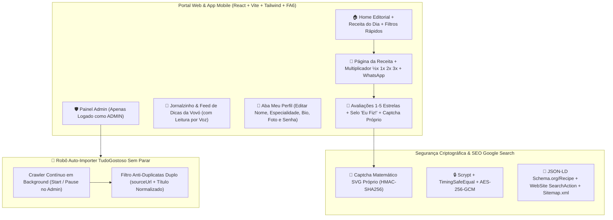

# 👵🍰 Caderno da Vovó — Plano Mestre de Arquitetura, SEO, Segurança, Monetização & Robô Auto-Importer (v3.0)

> [!IMPORTANT]
> **Repositório Oficial no GitHub:** [`https://github.com/Godopoa/caderno-da-vovo`](https://github.com/Godopoa/caderno-da-vovo)
> **Pasta Local do Projeto:** `C:\Users\dfuto\OneDrive\Documentos\CadernoDaVovo`
> **Servidores Ativos em Tempo Real:**
> - **Portal Web Editorial (Vite + React):** `http://localhost:5173`
> - **API Backend + Robô Auto-Importer + SEO (`sitemap.xml` / `robots.txt`):** `http://localhost:3333`

---

## 1. Padronização Visual & Design Editorial Afetivo (v3.0)

O design do portal **Caderno da Vovó** foi padronizado como um **Portal Web de Receitas Editorial Afetivo**, combinando legibilidade exemplar para avós e famílias com uma paleta de cores harmônica e distinta:

| Papel Visual | Cor Padronizada | Código Hex | Aplicação |
| :--- | :--- | :--- | :--- |
| **Primária (Framboesa / Cereja)** | Berry Rose | `#C83E5B` | Botões principais, categorias ativas, corações e destaques afetivos |
| **Secundária (Verde Sálvia / Ervas)** | Sage Herb Green | `#1E7E5A` / `#1B4332` | Barra superior, selo de saúde/calorias, Jornalzinho da Vovó e voz |
| **Clube VIP & Estrelas** | Warm Gold | `#D97706` | Coroas VIP, avaliações 5 estrelas e destaques especiais |
| **Fundo Editorial** | Porcelana Quente | `#F8F6F2` | Fundo suave que evita fadiga ocular em telas grandes |
| **Superfície de Cards** | Branco Alabastro | `#FFFFFF` | Cards de receitas limpos com sombras suaves e bordas `#E7E5E4` |

### Ocultação Inteligente de Botões Administrativos
- Os botões **`Admin`** e **`Importador`** **NÃO ficam visíveis** para visitantes comuns ou usuários gratuitos/VIP.
- Eles aparecem na barra de navegação superior **exclusivamente quando o usuário está autenticado com `role === 'ADMIN'`**.
- Para facilitar seus testes, o modal de **Entrar** possui o atalho **"Preencher Admin Demo"** (`admin@cadernodavovo.com.br` / `AdminVovo@2026`).

---

## 2. Novas Funcionalidades de Comunidade, Perfil, Segurança & SEO (v3.0)

### 2.1. 🤖 Robô Auto-Importer Sem Parar (`autoImporterWorker.ts`)
- Localizado no **Painel Admin → Aba "Robô Auto-Importer"**.
- **Como funciona:** Vasculha automaticamente categorias e páginas do `tudogostoso.com.br`, descobre novos links de receitas e importa uma receita após a outra continuamente em background.
- **Zero Repetição (Anti-Duplicatas):** Antes de importar qualquer URL, verifica no banco SQLite/Prisma tanto o `sourceUrl` exato quanto o `title` normalizado. Se já existir, pula automaticamente e passa para a próxima receita.
- **Controle em Tempo Real:** Botões para **Iniciar Robô Sem Parar** e **Pausar Robô**, ajuste de intervalo em segundos e console ao vivo com contadores de fila, receitas importadas na sessão e duplicadas ignoradas.

### 2.2. 🔐 Captcha Próprio da Vovó (`cryptoSecurity.ts`)
- Sistema de Captcha 100% próprio (sem depender de serviços externos):
  - Gera desafios matemáticos amigáveis em **SVG dinâmico** com linhas de ruído suaves (`GET /api/security/captcha`).
  - Assina a resposta esperada e o timestamp de expiração com **HMAC-SHA256**.
  - Protege o envio de **Comentários nas Receitas** e o **Cadastro de Contas**.

### 2.3. 📰 Jornalzinho & Feed de Notícias da Vovó (`NewsFeedPage.tsx`)
- Aba dedicada **Feed & Dicas** com matérias sobre truques de confeitaria, chás medicinais, conservação de alimentos e histórias de família.
- Inclui botão **"Ouvir Matéria"** (Text-to-Speech em Português), contador de curtidas e editor integrado para o Admin publicar novas matérias.

### 2.4. 💬 Sistema de Comentários, Estrelas e "Eu Fiz e Deu Certo!"
- Em cada receita, os leitores podem avaliar de **1 a 5 estrelas**, marcar o selo **"Eu fiz essa receita e aprovou! ✅"** e publicar seu comentário validado pelo Captcha Próprio.
- A nota média da receita é recalculada automaticamente no banco de dados.

### 2.5. 👵 Aba Meu Perfil & Edição de Usuário (`UserProfilePage.tsx`)
- Permite ao usuário logado editar:
  - Nome de exibição;
  - Especialidade culinária (ex.: *"Bolos Caseiros & Café da Tarde"*);
  - Biografia afetiva e foto/avatar;
  - Alteração de senha com re-hash `Scrypt`;
  - Galeria rápida das suas receitas favoritas salvas.

### 2.6. 🔎 SEO Completo & Integração Google Search (`SEOHead.tsx` + `sitemap.xml`)
- **JSON-LD Estruturado (`schema.org/Recipe` e `schema.org/WebSite`):** Injeta dinamicamente metadados de receitas (tempo de preparo ISO 8601, calorias, ingredientes, passos `HowToStep` e `AggregateRating`) para aparecer nos Rich Snippets do Google com foto e estrelas.
- **Endpoints Nativos de Indexação:**
  - `GET http://localhost:3333/sitemap.xml` — Sitemap XML dinâmico com todas as receitas e matérias do feed.
  - `GET http://localhost:3333/robots.txt` — Regras de indexação apontando para o Sitemap.

### 2.7. ⚖️ Calculadora de Porções & Lista no WhatsApp (`RecipeDetail.tsx`)
- Inspirado nos melhores portais internacionais (NYT Cooking / BBC Good Food):
  - Botões **`½x` (Metade)**, **`1x` (Original)**, **`2x` (Dobrar)** e **`3x` (Triplicar)** que recalculam automaticamente todas as quantidades numéricas dos ingredientes.
  - Botão **"Enviar Lista no WhatsApp"** que formata todos os ingredientes já multiplicados para enviar no celular.
