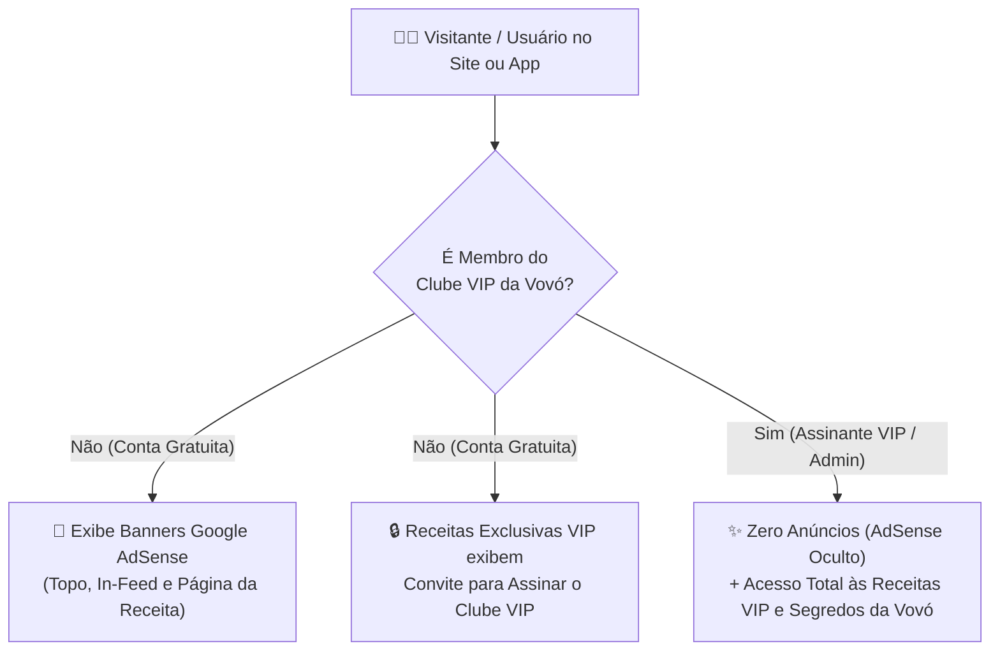

# 👵 Caderno da Vovó — Plano Arquitetural Completo (v2.0 — Portal Afetivo, Clube VIP, AdSense, Criptografia & Mobile)

> **Pasta Oficial do Projeto:** [`C:/Users/dfuto/OneDrive/Documentos/CadernoDaVovo`](file:///C:/Users/dfuto/OneDrive/Documentos/CadernoDaVovo)

---

## 1. Nova Direção Visual: Portal Culinário Afetivo ("Fofo que Combine com Avós")

Reformulação completa da estética: em vez de parecer uma tela de celular agigantada, o **Caderno da Vovó** agora é um **portal web culinário completo, charmoso, aconchegante e delicado**, inspirado em cadernos de receitas de família, confeitarias artesanais e grandes portais como o *TudoGostoso*:

- **Tipografia Editorial & Acolhedora:** Títulos em **Playfair Display** (serifada clássica de livros de culinária) combinada com **Nunito** e textura sutil de papel pontilhado artesanal (`#FDFBF7`).
- **Ícones FontAwesome 6 (`fa-solid`, `fa-regular`, `fa-brands`):** Integrados em toda a navegação, categorias, selos VIP, ingredientes, painel administrativo e auditoria de segurança.
- **Ilustrações Exclusivas Geradas por IA:**
  - **Logo Mascote (`/images/logo-vovo.jpg`):** Emblema circular da vovó chef com fouet e corações em tons terracota, creme e verde-sálvia.
  - **Banner Hero (`/images/hero-vovo.jpg`):** Ilustração estilo animação de uma vovó brasileira sorridente segurando um bolo caseiro quentinho em sua cozinha iluminada.
- **Conforto Visual Inteligente:** Barra superior discreta com ajuste opcional de letra (`A-` / `A+`) e alternância entre **Modo Claro (Papel de Caderno)** e **Modo Noturno**, sem deformar o layout desktop!

---

## 2. Segurança Criptográfica & Autenticação (`backend/src/services/cryptoSecurity.ts`)

1. **Hash de Senhas Resistente a Força Bruta:**
   - Algoritmo **`Scrypt` (`crypto.scryptSync`)** com **Salt aleatório de 16 bytes (128 bits)** por usuário.
   - Verificação de senha em tempo constante via **`crypto.timingSafeEqual`** (prevenção total contra *Timing Attacks*).
2. **Tokens Assinados Digitalmente (`HMAC-SHA256`):**
   - Sessões stateless assinadas com **HMAC-SHA256** contendo `userId`, `role` (`USER`, `VIP`, `ADMIN`), `isVip` e timestamp de expiração (`exp`).
3. **Cofre de Dados com Criptografia Simétrica Autenticada (`AES-256-GCM`):**
   - Dados sensíveis de monetização (como a **Chave PIX Oficial**) são criptografados no banco SQLite/Postgres usando **AES-256-GCM** com Vetor de Inicialização (`IV` de 96 bits) e Tag de Autenticação (`AuthTag` de 128 bits).
4. **Headers HTTP de Segurança & Log de Auditoria (`SecurityAuditLog`):**
   - Proteção ativa `X-Frame-Options: SAMEORIGIN`, `X-Content-Type-Options: nosniff`, `X-XSS-Protection` e sanitização de inputs.
   - Tabela `SecurityAuditLog` registrando cada login, falha de autenticação, ativação VIP e alteração administrativa com carimbo de data/hora e IP.

---

## 3. Monetização Dupla: Clube VIP da Vovó + Google AdSense

1. **Google AdSense (`AdSenseBanner.tsx`):**
   - Slots estratégicos configuráveis pelo Painel Admin (`Header Slot`, `In-Feed Slot`, `Recipe Detail Slot`) + `Publisher Client ID (ca-pub-...)`.
   - **Ocultação Automática para VIPs:** Assim que o usuário ativa o Clube VIP, 100% dos anúncios desaparecem instantaneamente.
2. **Clube VIP da Vovó (`AuthVipModal.tsx`):**
   - Planos **Mensal (`R$ 14,90/mês`)** e **Anual (`R$ 119,90/ano`)** com pagamento via PIX (chave descriptografada sob demanda do cofre AES-256) ou Cartão.
   - Desbloqueia receitas marcadas como `isVipOnly: true` e os *"Segredinhos da Vovó"*.

---

## 4. Painel Administrativo Completo (`AdminDashboardPage.tsx`)

Acessível pelo menu **`Painel Admin`** no topo do site (com botão de login rápido de 1 clique para demonstração):
- **Aba 1 — Visão Geral & Finanças:** Receita Mensal Estimada (MRR de Assinaturas VIP + CPM estimado do Google AdSense), total de receitas, visualizações, curtidas e botão de 1 clique para tornar qualquer receita **Exclusiva VIP** ou **Gratuita**.
- **Aba 2 — Google AdSense & Preços VIP:** Edição em tempo real do `ca-pub-...`, slots de anúncios, preços dos planos e chave PIX (criptografada ao salvar).
- **Aba 3 — Gestão de Usuários & Assinantes:** Tabela de usuários cadastrados permitindo conceder ou revogar o status **VIP** em 1 clique.
- **Aba 4 — Criptografia & Auditoria:** Painel técnico mostrando os algoritmos ativos (`Scrypt`, `HMAC-SHA256`, `AES-256-GCM`) e o feed ao vivo do `SecurityAuditLog`.
